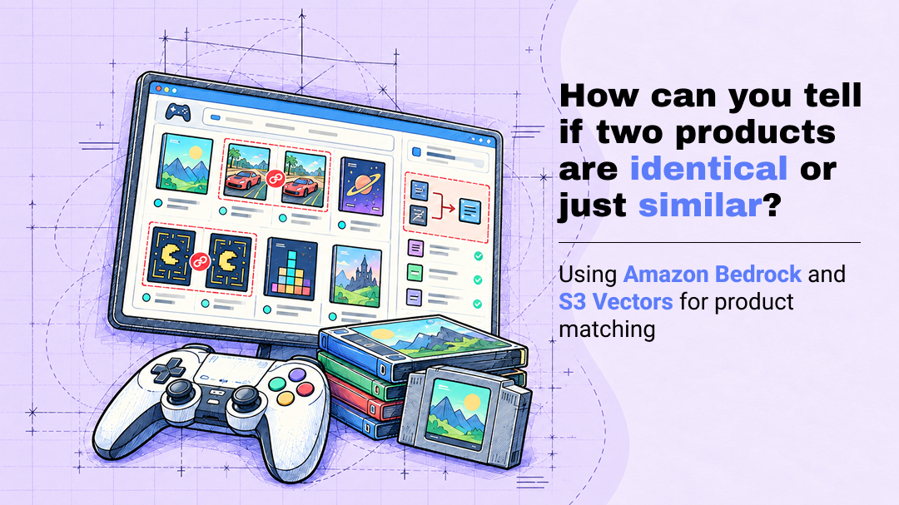
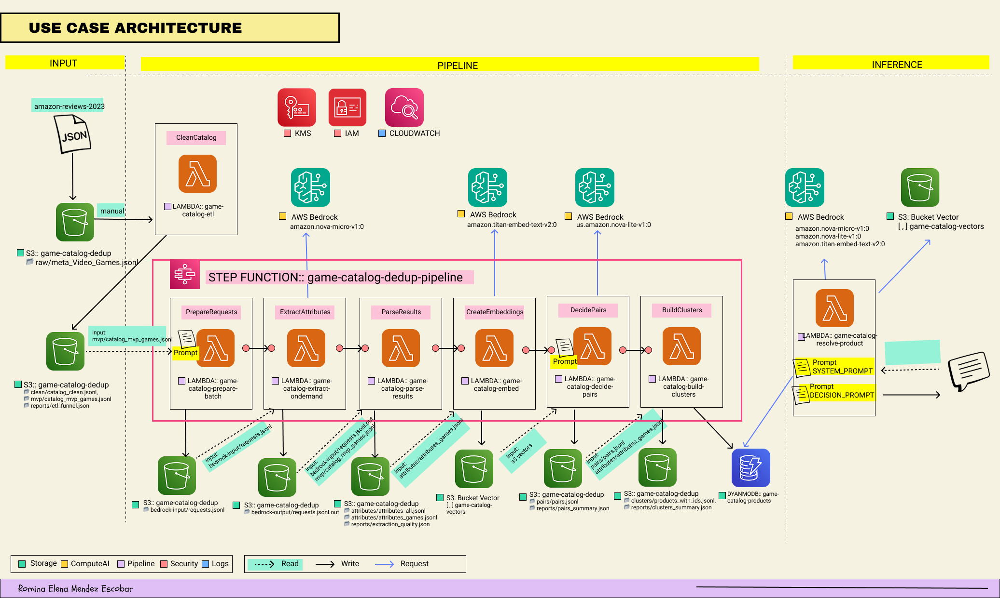

[](https://www.buymeacoffee.com/r0mymendez)

---

# 🎮 Identical or Similar? AI-Powered Product Matching with Amazon Bedrock and S3 Vectors

**Is it the same product?** A serverless pipeline that detects duplicate and variant listings in an e-commerce catalog, combining a language model, vector search and simple rules, with cost as a design constraint.



The use case is a video game catalog: the same game can be sold for different platforms, in different editions and formats, as a budget reprint or refurbished, and its title can be written in many ways ("GTA: Vice City" vs "Grand Theft Auto: Vice City", "Black Ops II" vs "Black Ops 2"). Some of those listings are the same product; others look almost identical but are not.

> 📝 This repository accompanies the article [Identical or Similar? AI-Powered Product Matching with Amazon Bedrock and S3 Vectors](https://dev.to/aws-builders/identical-or-similar-ai-powered-product-matching-with-amazon-bedrock-and-s3-vectors-3pm)].

---

## 📊 Results at a glance

Processed with the final version of the pipeline (prompt v8) on the 20 best-selling video game franchises:

| Metric | Value |
|---|---|
| Products processed | 3,740 |
| Not actually games (bundles, DLC, accessories, merchandise) | 825 (22%) |
| Games | 2,915 |
| **Products identified** (`canonical_id`) | **2,125** |
| **Listings flagged as duplicates** | **790 (27.1% of games)** |
| Game families (same game, any platform or edition) | 972 |
| Candidate pairs decided by rules | 97.7% |
| Candidate pairs decided by Nova Lite (gray zone) | 2.3% |
| End-to-end pipeline time | 14 min 4 s (extraction: 8 min 26 s) |
| Estimated extraction cost (Nova Micro) | ~$0.24 |

---

## 🏗️ Architecture



The solution has three parts:

- **📥 Input:** the [Amazon Reviews 2023](https://amazon-reviews-2023.github.io/) *Video Games* metadata is cleaned, and the products of the 20 best-selling franchises are selected.
- **⚙️ Pipeline:** an AWS Step Functions workflow extracts normalized attributes with a language model, turns each product into a vector, compares each product with its nearest neighbors, decides whether they are duplicates, variants or different products, and stores the result in DynamoDB.
- **⚡ Real time:** a Lambda function resolves a new listing or a natural language query ("fifa 14 ps3 digital code") and answers whether that product already exists.

### Services

| Category | Service | Role |
|---|---|---|
| 🟩 Storage | Amazon S3 | Data for each pipeline stage, versioned by run |
| 🟩 Storage | Amazon S3 Vectors | Product vectors and similarity search |
| 🟩 Storage | Amazon DynamoDB | Each product with its `canonical_id` and `family_id` |
| 🟨 Compute AI | Amazon Bedrock – Nova Micro | Attribute extraction |
| 🟨 Compute AI | Amazon Bedrock – Titan Text Embeddings V2 | Embeddings |
| 🟨 Compute AI | Amazon Bedrock – Nova Lite | Decisions in the gray zone |
| 🟪 Pipeline | AWS Lambda | Each processing step |
| 🟪 Pipeline | AWS Step Functions | Orchestration of the batch pipeline |
| 🟥 Security | AWS IAM, AWS KMS | Least-privilege roles, encryption at rest |
| 🟦 Logs | Amazon CloudWatch | Logs and metrics |

### Lambda functions

| Folder | Function | Input | Output |
|---|---|---|---|
| `ETL01` | `game-catalog-etl` | `raw/` | `clean/`, `mvp/`, `reports/` |
| `SP01` | `game-catalog-prepare-batch` | `mvp/` | `bedrock-input/` |
| `SP02` | `game-catalog-extract-ondemand-access` | `bedrock-input/` | `bedrock-output/` |
| `SP03` | `game-catalog-parse-results` | `bedrock-output/` | `attributes/`, `reports/` |
| `SP04` | `game-catalog-embed` | `attributes/` | S3 Vectors |
| `SP05` | `game-catalog-decide-pairs` | S3 Vectors | `pairs/`, `reports/` |
| `SP06` | `game-catalog-build-clusters` | `pairs/`, `attributes/` | `clusters/`, `reports/`, DynamoDB |
| `RT01` | `game-catalog-resolve-product` | Listing or query | Response (+ DynamoDB and S3 Vectors on register) |

Every stage writes to its own S3 prefix, organized by run (for example `attributes/top20-v8/`), so any step can be re-run without repeating the previous ones and runs can be compared with each other.

---

## 🧠 How the decision works

1. **🔎 Find:** for each product, S3 Vectors returns the nearest neighbors (cosine distance < 0.25).
2. **📏 Decide with rules:** if both products have the same `base_title`, they are compared on platform, edition, format and region → **duplicate** or **variant**.
3. **🤖 Gray zone:** if the titles differ but the vectors are very close (distance < 0.08), Nova Lite decides.
4. **🧩 Group:** pairs are grouped with a constrained union-find into `canonical_id` (same product) and `family_id` (same game).

> Distance is used to **find** candidates; attributes are used to **decide**.

---

## 📁 Repository structure

```
.
├── eda_video_games.ipynb          # Exploratory data analysis
├── img/                           # Architecture and diagrams
└── aws/
    ├── S3/
    │   └── create_s3_bucket.sh
    ├── S3Vectors/
    │   └── create_vector_index.sh
    ├── DynamoDB/
    │   └── create_dynamodb_table.sh
    ├── lambda/
    │   ├── deploy_lambda.sh
    │   ├── trust-policy.json          # Lambda trust policy (shared)
    │   ├── ETL01-game-catalog-etl/
    │   │   ├── lambda_function.py
    │   │   ├── policy-role.json       # Least-privilege policy of this function
    │   │   ├── configuration.md       # Memory, ephemeral storage, timeout
    │   │   └── test/                  # Test events
    │   ├── SP01-game-catalog-prepare-batch/
    │   ├── SP02-game-catalog-extract-ondemand/
    │   ├── SP03-game-catalog-parse-results/
    │   ├── SP04-game-catalog-embed/
    │   ├── SP05-game-catalog-decide-pairs/
    │   ├── SP06-game-catalog-build-clusters/
    │   └── RT01-game-catalog-resolve-product/
    └── step-function/
        ├── game-catalog-dedup-pipeline.json
        ├── game-catalog-dedup-pipeline.png
        ├── LambdaInvokeScopedAccessPolicy.json
        └── trust-policy.json
```

---

## ✅ Prerequisites

- An AWS account with access to Amazon Bedrock in `us-east-1`, with these models enabled: **Amazon Nova Micro**, **Amazon Nova Lite** and **Amazon Titan Text Embeddings V2**.
- AWS CLI v2, configured with credentials that can create the resources below.
- Python 3.12 (for the EDA notebook) and `zip`.
- The dataset file `meta_Video_Games.jsonl`, downloaded from [Amazon Reviews 2023](https://amazon-reviews-2023.github.io/).

---

## 🚀 Deployment

Create the resources in this order, because the Step Function references the Lambda functions by name.

> 🔐 The IAM policies use the placeholder `<account_number>`. Replace it with your AWS account ID before deploying.

### 1. Storage

```bash
bash aws/S3/create_s3_bucket.sh
bash aws/S3Vectors/create_vector_index.sh
bash aws/DynamoDB/create_dynamodb_table.sh

aws s3 cp data/meta_Video_Games.jsonl s3://game-catalog-dedup/raw/meta_Video_Games.jsonl
```

### 2. Lambda functions

For each function, `deploy_lambda.sh` creates an IAM role (`<function-name>-role`) with the shared trust policy, its `policy-role.json` and the managed `AWSLambdaBasicExecutionRole` policy (CloudWatch Logs), packages the code and creates the function, or updates its code if it already exists.

```bash
cd aws/lambda
# Usage: ./deploy_lambda.sh <folder> <function-name> <memory-MB> <timeout-s> [layer-arn] [ephemeral-MB]
./deploy_lambda.sh ETL01-game-catalog-etl              game-catalog-etl                     2048 900 <pandas-layer-arn> 2048
./deploy_lambda.sh SP01-game-catalog-prepare-batch     game-catalog-prepare-batch           1024 180 "" 1024
./deploy_lambda.sh SP02-game-catalog-extract-ondemand  game-catalog-extract-ondemand-access  512 900
./deploy_lambda.sh SP03-game-catalog-parse-results     game-catalog-parse-results           1024 300 "" 1024
./deploy_lambda.sh SP04-game-catalog-embed             game-catalog-embed                    512 900
./deploy_lambda.sh SP05-game-catalog-decide-pairs      game-catalog-decide-pairs            1024 900
./deploy_lambda.sh SP06-game-catalog-build-clusters    game-catalog-build-clusters          1024 900
./deploy_lambda.sh RT01-game-catalog-resolve-product   game-catalog-resolve-product          512 60
```

All functions use the **Python 3.12** runtime on **x86_64**. The values match the `configuration.md` file of each function. The ETL needs the AWS-managed layer **AWSSDKPandas-Python312** (copy its current ARN from the Lambda console: *Layers → Add a layer → AWS layers*) and 2 GB of ephemeral storage, because it writes the cleaned catalog to `/tmp` before uploading it.

### 3. Step Function

Create a role that Step Functions can assume, with the policy that allows it to invoke only the six pipeline functions, and then create the state machine:

```bash
aws iam create-role --role-name game-catalog-dedup-pipeline-role \
  --assume-role-policy-document file://aws/step-function/trust-policy.json

aws iam put-role-policy --role-name game-catalog-dedup-pipeline-role \
  --policy-name LambdaInvokeScopedAccessPolicy \
  --policy-document file://aws/step-function/LambdaInvokeScopedAccessPolicy.json

aws stepfunctions create-state-machine \
  --name game-catalog-dedup-pipeline \
  --definition file://aws/step-function/game-catalog-dedup-pipeline.json \
  --role-arn <step-functions-role-arn> \
  --type STANDARD \
  --region us-east-1
```

---

## ▶️ Running the pipeline

**1. Clean the catalog** by invoking `game-catalog-etl` once with this event:

```json
{ "bucket": "game-catalog-dedup", "key": "raw/meta_Video_Games.jsonl" }
```

**2. Start the Step Function** with this input:

```json
{
  "bucket": "game-catalog-dedup",
  "run_name": "top20-v8",
  "title_contains": [
    "\\bmario\\b", "\\btetris\\b", "\\bpok[eé]mon\\b", "\\bcall of duty\\b",
    "\\bgrand theft auto\\b|\\bgta\\b", "\\bminecraft\\b", "\\bfifa\\b",
    "\\bassassin'?s creed\\b", "\\bresident evil\\b", "\\bfinal fantasy\\b",
    "\\bwii (sports|fit|play|party|music)\\b", "\\blego\\b", "\\bthe sims\\b",
    "\\bnba 2k", "\\bzelda\\b", "\\bmadden\\b", "\\bneed for speed\\b",
    "\\bsonic\\b", "\\bmonster hunter\\b", "\\bred dead\\b"
  ],
  "model_id": "us.amazon.nova-micro-v1:0",
  "prompt_version": "v8",
  "index_name": "games-v2",
  "decision_model_id": "us.amazon.nova-lite-v1:0",
  "pairs_run": "pairs-top20-v8",
  "clusters_run": "clusters-top20-v8",
  "attribute_keys": ["attributes/top20-v8/attributes_games.jsonl"]
}
```

| Parameter | Meaning |
|---|---|
| `run_name` | Prefix for this run in S3 (keeps every version separate) |
| `title_contains` | Regular expressions that select the products in scope |
| `model_id` | Extraction model (Nova Micro) |
| `decision_model_id` | Gray-zone decision model (Nova Lite) |
| `index_name` | S3 Vectors index |
| `pairs_run`, `clusters_run` | Prefixes for the pairs and clusters outputs |

> ⚠️ Before a new run, empty the vector index and the DynamoDB table: writes add and overwrite, but never delete, so results from different versions would mix.

Each function also has ready-to-use test events in its `test/` folder. The events for `prepare-batch`, `extract-ondemand` and `parse-results` use a small `test-sample` run (20 products), so they can be tried without reprocessing the whole catalog.

---

## ⚡ Real-time usage

Invoke `game-catalog-resolve-product` with a **search**:

```json
{ "query": "pokemon esmeralda game boy advance" }
```

or with a full product to **register** it:

```json
{ "product": { "parent_asin": "B000000000", "title": "...", "store": "...", "categories": ["..."] } }
```

The response includes the `decision` (`duplicate`, `variant`, `new` or `out_of_scope`), the `canonical_id`, the `family_id`, the extracted attributes and the closest candidates.

> ⚠️ Register mode writes to DynamoDB and S3 Vectors. The test products use the keys `TEST-0001` and `TEST-0002`; delete them afterwards if you don't want them in the catalog.

---

## ✍️ Prompt iterations

| Version | Change | Why |
|---|---|---|
| v1 | Initial prompt | — |
| v2 | Default edition `Standard` | `unknown` was splitting duplicates |
| v3 | Removed `franchise` and `release_year` | Unused and error-prone |
| v4 | Sequel numbers; packs are bundles | "Black Ops 2" lost its number |
| v5 | Toys, replicas and compilations are not games | A Zelda sword was extracted as a game |
| v6 | Product condition is not an edition | "Renewed" appeared as an edition |
| v7 | Purpose section, few-shot examples, budget reprints, format rule | Roman numerals, abbreviations, "Platinum" |
| v8 | Platform read from categories, closed platform list, examples with categories | v7 left 14% of games without platform |

The examples in the prompt deliberately use franchises **outside** the evaluated set, so the results measure generalization rather than memorized answers.

---

## ⚠️ Disclaimer

This is an exploratory MVP and is not intended for production use as is.

- The results come from a single run on a subset of 3,740 products; more data samples are needed to validate them.
- The prompt was tuned over several test rounds on that same subset, so it may behave differently on other catalogs.
- The rules work on the attributes extracted by the model: extraction errors propagate to the search and the decision.
- Thresholds, rules and business criteria were set empirically, and the models have not been validated against a labelled reference set.


---

## ⚠️ Limitations

- Unofficial reproductions and bundles with accessories can be grouped with the original game.
- Region is unknown in about 90% of listings; listings without region are assumed to be US.
- Regional editions recognized only by the title's language (for example "Smaragd") are treated as the same product.
- The model's confidence score does not reliably flag its own errors.
- Bedrock batch inference was not available on the account, so extraction uses parallel on-demand calls, limited by the requests-per-minute quota.

## 🔭 Future work

- Define the whole infrastructure as code (Terraform, AWS SAM or CDK).
- Enforce the output schema with structured outputs (tool use in the Converse API).
- Build a labelled reference set to measure precision and recall for every prompt version.
- Capture user feedback on search results to measure quality in real use.
- Scale to the full catalog with Step Functions Distributed Map.
- Configure the EventBridge rule so the ETL runs automatically on new uploads to `raw/`.

---

## 📚 References

This project uses the [Amazon Reviews 2023](https://amazon-reviews-2023.github.io/) dataset. If you use it, please cite:

```bibtex
@article{hou2024bridging,
  title={Bridging Language and Items for Retrieval and Recommendation},
  author={Hou, Yupeng and Li, Jiacheng and He, Zhankui and Yan, An and Chen, Xiusi and McAuley, Julian},
  journal={arXiv preprint arXiv:2403.03952},
  year={2024}
}
```

## 👩‍💻 Author

**Romina Elena Mendez Escobar**